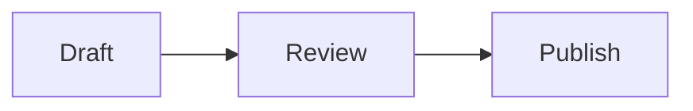

Tunelito is local-first. It does not upload your source HTML or Markdown to a hosted backend.

## Runtime pieces

The CLI starts a local server for one HTML or Markdown file, or a folder of HTML and Markdown files. The server reads HTML from disk or renders Markdown into a readable page, injects the Tunelito browser client into served page responses, and serves non-hidden assets from the selected file directory or folder root. In folder mode, directory URLs without an authored index receive a themed Tunelito landing page, and rendered Markdown pages receive a filtered served-document tree in the left sidebar. In Markdown, GFM footnotes become numbered two-way links, fenced `mermaid` blocks render as diagrams, and other fenced languages remain code.

The browser client handles:

- text selection
- comment composition
- comment sidebar
- assigned reviewer names and explicit renaming
- unanchored page notes and site-wide notes
- optional presenter pointer halos on fine-pointer devices
- live sync over WebSocket, plus WebRTC data channels in `--ephemeral`
- highlight rendering when the browser supports it
- reload notices when the file changes
- an opt-in local-owner Markdown source editor when `--editable` is enabled

The server handles:

- review-key access control
- WebSocket upgrades
- WebRTC signaling and fallback relay events in `--ephemeral`
- comment validation
- Markdown persistence, unless `--ephemeral` is enabled
- file watching
- conditional, atomic Markdown source saves for the direct local owner when explicitly enabled
- packaged same-origin Mermaid assets for Markdown pages that contain diagrams
- generated root/nested folder landing pages that list only immediate served content
- a recursive Markdown navigation model whose folders remain independently collapsed in the browser
- page-specific and site-wide comment streams when serving a folder
- optional Cloudflare Tunnel startup

When `--agent` is enabled, a separate worker handles:

- watching the persistent comments file, with interval polling as a fallback
- invoking Codex, Claude Code, or a custom local command
- continuing comments that return `needs_followup` with completed and remaining tasks
- recording status in `.tunelito/agent/state.json`
- writing a readable `.tunelito/agent/log.md`

Every served target gets an atomic local `.tunelito/session.json` lifecycle record for second-shell status and recovery. When `--agent-session` is enabled, Tunelito does not invoke another CLI: the server process watches the comments inbox, claims actionable comments for the current coding-agent session, prints bounded prompts, shows reviewer-facing status on comment cards, exposes the same tracker through `tunelito inbox status`, and records results through `tunelito inbox record`.

## Source files change only through an explicit editor save

The injection happens only in the HTTP response. Your source HTML and Markdown files remain untouched by Tunelito's annotation layer. Without `--editable`, Tunelito has no browser source-write route.

With `--editable`, the direct loopback owner response adds an **Edit source**
control to safely served Markdown pages. Public tunnel and forwarded responses
remain read-only. The editor reads exact UTF-8 source, keeps it outside comment
anchoring, and saves only on an explicit action or Cmd/Ctrl-S. Saves require the
strong revision opened by that browser, revalidate the served path, enforce a
2 MiB request limit, and atomically replace the source while preserving its
permissions. This is optimistic conflict protection: Tunelito rechecks the
revision immediately before replacement. A newer external or agent edit it
observes produces a conflict, and the browser draft remains available.

The editor never exposes generated folder landing pages, HTML, hidden or blocked
paths, symlink escapes, comments files, `tunelito.config.json`, or `.tunelito/`
state. A comment whose selected text disappears after an edit remains readable
and is labeled **Selection no longer found in this version**.

Authored `index.html` and `index.md` files keep precedence. Generated folder landing pages and the Markdown navigation tree are response-only UI: they exclude hidden paths, comments/session/config state, unsupported file types, and symlink escapes, and they never create an index file in the served folder.

## Safe collapsible sections

Markdown can use native disclosures without enabling arbitrary raw HTML:

```markdown
<details>
<summary>Project group</summary>

Markdown content remains reviewable here.

</details>
```

Tunelito renders only `<details>` and `<summary>`. It removes every attribute except a normalized boolean `open` on `<details>`, escapes all other raw HTML including scripts and event handlers, keeps literal tags inside inline and fenced code, and leaves complete HTML comments hidden. When a sidebar comment targets text inside a collapsed disclosure, Tunelito opens its containing disclosures before scrolling to the anchor.

## GFM footnotes

Use normal GFM footnote syntax in Markdown:

```markdown
The procurement decision requires approval.[^approval]

[^approval]: Confirm the final approver before publication.
```

Tunelito renders each defined reference as a numbered link and collects referenced definitions in an accessible footnotes section at the end of the document. Repeated references receive distinct return links. Definition text stays inside the normal comment surface, so reviewers can annotate it; persisted comments still reattach by quote when the rendered footnote markers change legacy text offsets. Undefined references and footnote syntax inside inline or fenced code remain literal.

Footnote definitions use the same raw-HTML, URL, and media safety rules as the rest of rendered Markdown. Tunelito leaves the source file byte-for-byte unchanged.

## Markdown links

Only the browser knows which origin is serving the page, so the Markdown client classifies links there. An `http:` or `https:` link to another origin gets `target="_blank"` and `rel="noopener noreferrer"`. Opening a cited report leaves the review room in its tab, and the new tab cannot reach back to it. These links stay in the current tab:

- absolute URLs on the served origin, such as a tunnel URL that points at another served note
- relative links such as `workflow-final.md`
- root-relative links such as `/notes/next.md`
- fragments such as `#verification`, footnote references, and back-links

Tunelito does not attach click handlers to links, so Cmd/Ctrl-click and middle-click behave as they normally do in the browser. `mailto:` links are left alone, and anchors that already set `target` or `download` keep them; cross-origin ones still get the external link colour. HTML pages are served as authored, and the new-tab rule applies only to rendered Markdown.

A CommonMark link title becomes the anchor's `title` attribute. Status briefings can put the tracker summary into the title:

```markdown
[TLL-563](http://127.0.0.1:3100/TLL/issues/TLL-563 "Fix login redirect · todo · medium")
```

Tunelito also shows a small local card for titled links. It splits the title on `·` or `|` and treats `low`, `medium`, `high`, or `critical` as the priority. It never fetches the link. While the card is open on hover or keyboard focus, Tunelito moves the title into a data attribute so the browser does not show its native tooltip on top of the card, and points `aria-describedby` at the card. Leaving or blurring the link restores the `title`, so the native tooltip still works wherever the card is unavailable.

The external link colour follows the same origin check as the new-tab rule: only links to another origin get it, so a same-origin absolute link looks like any other internal link.

## Resolver-backed link previews

Bare links such as `[TLL-563](http://127.0.0.1:3100/TLL/issues/TLL-563)` can fill the same card from a tracker's JSON API. Configure a rule with `--link-preview <regex> <url-template>` or the `linkPreviews` config key. Without a rule, nothing changes.

1. The server renders the page with `data-tunelito-link-previews="on"`, but only for viewers allowed to resolve.
2. When the pointer or keyboard focus reaches a link with no authored title, the browser calls Tunelito's same-origin `/__tunelito/link-preview?href=…` route. It sends an `x-tunelito-link-preview: 1` header.
3. The server matches the authored `href` against each rule in order and builds the resolver URL from the template. Captures are URL-encoded, and the resolver's scheme and host are fixed in the template.
4. The server fetches the URL itself and returns only plain-text `title`, `status`, and `priority` strings. The browser puts them in the card with `textContent`.

The fetch fails closed. Tunelito returns no card on any of these:

- a resolver host that is not loopback, unless `--link-preview-allow-remote` was passed. Remote resolvers must also use `https://` and cannot be a private, link-local, or cloud-metadata address literal.
- a resolver hostname whose DNS answers break the host policy. Tunelito looks the host up once per fetch and checks every answer. A loopback rule such as `localhost` must resolve only to loopback. A remote rule must resolve only to public addresses, so a private, loopback, link-local, CGNAT, metadata, or IPv4-mapped answer refuses the fetch. Tunelito then connects only to the addresses it checked, with the hostname kept for `Host`, TLS SNI, and certificate validation, so DNS rebinding cannot redirect the request.
- a `match` regex that runs longer than 25 ms on one href. Tunelito stops it, returns no card, skips that href for 15 seconds, and logs one warning line per minute at most. Other requests keep being served.
- a redirect, a non-2xx status, a non-JSON `content-type`, a body over 64 KiB, invalid UTF-8 or JSON, or no response within 3 seconds
- a field that is not a string, number, or boolean. Values are trimmed, control characters are stripped, and each is capped at 200 characters.

Tunelito caches results for 60 seconds and failures for 15 seconds, keeps at most 256 entries, and runs no more than four resolver requests at once. Extra requests get `503` and no card. Tunelito never sends cookies or the review key to the resolver.

A rule can add request headers, for a tracker that needs a token. Values read secrets from `${env:NAME}` and are filled in only at fetch time, so the token is never stored in the rule, printed, logged, or returned to the browser. Headers are off unless the command line passes `--link-preview-env NAME` for each variable, and a project `tunelito.config.json` cannot define them. They go only to that rule's resolver origin, over `https://` or loopback `http://`, and a redirect gets no card. A rule with headers resolves only for the direct local owner, even with `--link-preview-visitors`, and its results are cached apart from rules without headers. If the variable is missing or empty, the rule shows no card and Tunelito warns once with the variable's name.

The route sits behind the review key. It also refuses cross-site callers: a request needs the custom header, a matching `Origin` if one is sent, and `Sec-Fetch-Site: same-origin` if that header is sent. By default only the direct local owner can resolve. Public tunnel and forwarded requests get `403` and a page without the preview flag, so visitors cannot make your machine fetch from your local tracker. `--link-preview-visitors` lets keyed visitors resolve too. They can only reach the configured resolver origin, with hrefs capped at 512 characters, and one upstream slot always stays free for the owner. The flag is refused with `--no-auth`. Each regex runs on the server under the 25 ms limit, so keep `match` patterns anchored and simple; a pattern that times out just shows no card. Served HTML pages are unchanged; resolver previews are a Markdown-only feature.

## Copying code blocks

Every fenced code block in a rendered Markdown page gets a small copy button in its top-right corner. It appears when the pointer is over the block or when keyboard focus reaches it, and it stays visible on touch screens. The button copies the code exactly as written, without the button label or any added decoration, and screen readers hear "Copied code to clipboard". Tunelito uses the browser's async clipboard on `http://127.0.0.1` and HTTPS tunnel URLs, and falls back to a legacy copy if the browser denies it.

The browser adds the button after the page loads. It contains only icons and is marked as review chrome, so selecting code for a comment, persisted quotes, and section mapping work the same as before. Mermaid diagrams and served HTML pages get no button.

Long lines wrap by default, including long URLs and paths, so a block never needs a horizontal scrollbar. A wrap toggle sits beside the copy button; it is a pressed/unpressed button that switches that one block between wrapping and sideways scrolling. Wrapping only changes how the block is displayed, so copying still returns the original lines with no added newlines. Start a session with `--no-code-wrap`, or set `"codeWrap": false` in [configuration](/configuration#code-block-wrapping), to make scrolling the default.

## Mermaid diagrams

Use a normal Mermaid fence in a Markdown document:

````markdown

````

Tunelito loads Mermaid from its installed package, not a CDN, so rendering remains local/offline and the asset uses the same review-key protection as the page. It initializes Mermaid once per page with strict security, HTML labels and click actions disabled, and bounded text/edge limits. Valid diagrams become responsive SVG. The escaped source remains available under **View Mermaid source**; invalid syntax, an oversized diagram, or a runtime failure opens that source and shows a readable error instead of leaving a blank page. Add Mermaid `accTitle` and `accDescr` statements when the diagram needs an explicit accessible name and description.

## Persistence

Comments are written to Markdown beside the page by default:

```text
page.html
page.comments.md
```

Markdown targets use the same sidecar shape:

```text
notes.md
notes.comments.md
```

For folder targets, the default inbox is beside the folder:

```text
site/
site.comments.md
```

The Markdown remains readable if Tunelito is never opened again. Hidden metadata inside the file lets Tunelito restore live comments after a restart and tie new comments to a stable reviewer identity for renames. Folder comments include visible scopes and page paths so a person or coding agent can map page feedback back to the right HTML or Markdown file and treat site feedback as applying across the folder.

`tunelito comments inspect` reads that same hidden metadata and prints a derived `tunelito-comments` JSON index for agents and diagnostics. The command does not write to the comments file or source files. When an agent ledger path is known, the index also includes the same pending, claimed, resolved, and follow-up status used by `inbox status` and browser comment-card badges.

The local agent worker and active-agent inbox commands do not edit this Markdown file. They treat comments as an append-only inbox and write resolution state beside the served root under `.tunelito/agent/`. That hidden ledger is not served as static content and does not trigger document reload notices. It also stores continuation state for comments that need multiple bounded passes, so the next agent prompt can continue from saved remaining tasks instead of redoing completed work.

## Live mode

`--ephemeral` stores comments in memory only. The browser client shares comments, cursors, and selection highlights over WebRTC data channels when possible. The WebSocket connection remains the authenticated control channel for room membership, WebRTC signaling, reload notices, and fallback relay when peer-to-peer connectivity is unavailable.
